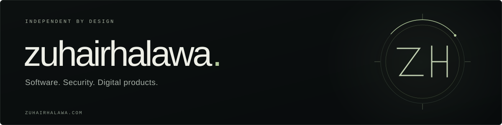

<!--
  zuhairhalawa / GitHub profile
  Cyber-terminal design. Real work, real links, no invented metrics.
-->

<div align="center">
  

  <br/>

  <a href="https://www.linkedin.com/in/zuhair-hussein-halawa/"></a>
  <a href="https://nfcer.ae"></a>
  <a href="https://github.com/advisories?query=credit%3Azuhairhalawa"></a>
  <a href="https://github.com/sponsors/zuhairhalawa"></a>

  <p><code>Computer Science</code> &nbsp; <code>Software Engineering</code> &nbsp; <code>Security Research</code> &nbsp; <code>UAE</code></p>
</div>

---

### `root@zuhair:~# whoami`

```console
┌──(zuhairhalawa@dev)-[~/portfolio]
└─$ cat mission.txt

  BUILD what matters.
  BREAK assumptions, not trust.
  TEST the edge cases.
  SHIP what works.

  [ interests ]  software engineering / cybersecurity / useful products
  [ location  ]  United Arab Emirates
  [ mode      ]  always building
```

I'm a Computer Science student who likes taking ideas past the prototype: building products, finding failure cases, improving reliability, and learning by shipping. My work spans security-focused engineering, developer tooling, web applications, and applied AI.

## `00 // SECURITY INTELLIGENCE`

> **Verified work beats a CVE counter.** My public security contributions include accepted metadata updates to the official GitHub Advisory Database: corrected patched-version boundaries, remediation references and cross-project vulnerability intelligence. I distinguish these **Analyst-style contributions** from original vulnerability discovery.

<table>
  <tr>
    <td width="33%" valign="top">
      <strong>APOSTROPHECMS</strong><br/>
      <sub>Patched-version and remediation mapping</sub><br/><br/>
      <a href="https://github.com/github/advisory-database/pull/10651">✓ Merged PR #10651</a>
    </td>
    <td width="33%" valign="top">
      <strong>FACTURASCRIPTS</strong><br/>
      <sub>CSV injection: fixed-release boundary</sub><br/><br/>
      <a href="https://github.com/github/advisory-database/pull/10639">✓ Merged PR #10639</a>
    </td>
    <td width="34%" valign="top">
      <strong>DOLIBARR</strong><br/>
      <sub>Correcting an affected version range</sub><br/><br/>
      <a href="https://github.com/github/advisory-database/pull/10672">✓ Merged PR #10672</a>
    </td>
  </tr>
</table>

**[↳ ENTER SECURITY RESEARCH PORTFOLIO](security/README.md)** · [8 verified merged examples](security/evidence.json) · [Public GitHub advisory credits](https://github.com/advisories?query=credit%3Azuhairhalawa) · [All merged Advisory Database PRs](https://github.com/github/advisory-database/pulls?q=is%3Apr+is%3Amerged+author%3Azuhairhalawa)

<sub>Accepted Advisory Database edits support accurate vulnerability metadata. They do not by themselves establish that I discovered the underlying CVEs or wrote the vendor fixes.</sub>

---

## `01 // SYSTEMS ONLINE`

<p><sub>Selected public work and real products. Click a project to inspect the code, try it live, or see the actual scope.</sub></p>

<table>
  <tr>
    <td width="50%" valign="top">
      <h3><a href="https://github.com/zuhairhalawa/TapTrail">01 / TapTrail</a> <code>PUBLIC</code></h3>
      Turn screenshots into interactive walkthroughs and export one self-contained HTML guide that works offline.
      <br/><br/>
      <a href="https://zuhairhalawa.github.io/TapTrail/"><strong>↳ LIVE DEMO</strong></a> · <a href="https://github.com/zuhairhalawa/TapTrail">SOURCE</a>
      <br/><sub>React / TypeScript / IndexedDB / Vite</sub>
    </td>
    <td width="50%" valign="top">
      <h3><a href="https://github.com/zuhairhalawa/studyai">02 / StudyAI</a> <code>PUBLIC</code></h3>
      Local-first lecture study platform with PowerPoint imports, flashcards, practice exams, and an optional slide-grounded tutor.
      <br/><br/>
      <a href="https://github.com/zuhairhalawa/studyai"><strong>↳ EXPLORE REPO</strong></a>
      <br/><sub>React / TypeScript / Cloudflare Workers / Gemini</sub>
    </td>
  </tr>
  <tr>
    <td width="50%" valign="top">
      <h3><a href="https://nfcer.ae">03 / NFC'er</a> <code>FOUNDER</code></h3>
      Building a real NFC products business and commerce platform with smart business cards and digital business profiles.
      <br/><br/>
      <a href="https://nfcer.ae"><strong>↳ WEBSITE</strong></a>
      <br/><sub>Laravel / PHP / JavaScript / MySQL / NFC</sub>
    </td>
    <td width="50%" valign="top">
      <h3><a href="https://github.com/zuhairhalawa/Trapline">04 / Trapline</a> <code>PUBLIC</code></h3>
      A playable three-level browser puzzle: lure a fictional intruder into a honeypot while protecting a legitimate data packet.
      <br/><br/>
      <a href="https://zuhairhalawa.github.io/Trapline/"><strong>↳ PLAY IT</strong></a> · <a href="https://github.com/zuhairhalawa/Trapline">SOURCE</a>
      <br/><sub>Browser game / Puzzle systems / Testing</sub>
    </td>
  </tr>
</table>

## `02 // SECURITY LAB & PRIVATE BUILDS`

> [!NOTE]
> These are accurately labeled **private or research-stage** projects. Private source is not linked or presented as independently audited.

| Project | What I'm working on | State |
| :--- | :--- | :--- |
| **RELAY** | Experimental end-to-end encrypted messenger; reliability, synchronization and security-oriented engineering. Not independently security-audited. | `PRIVATE / EARLY BETA` |
| **ZeroTrace Lab / [BioHACK3D '26](https://csaw.io/competition/biohack-3d)** | Computer vision and adversarial-ML research involving physical authentication. | `PRIVATE / RESEARCH` |
| **AI-generated code security research** | Graduation work exploring automated detection and repair of software security and maintainability issues. | `ACADEMIC` |
| **[Algorithm visualizations](https://github.com/zuhairhalawa/lis-visualizer)** | Visual explanations of longest increasing subsequence and [longest path / NP-completeness](https://github.com/zuhairhalawa/longest-path-visualizer). | `PUBLIC` |

## `03 // DEV TOOLS INSTALLED`

Practical, published command-line tools. Their repositories contain the actual code and instructions.

| Utility | What it does | |
| :--- | :--- | :--- |
| **[FreshQ](https://github.com/zuhairhalawa/FreshQ)** | Find fresh, unanswered GitHub Discussions. | [npm](https://www.npmjs.com/package/@zuhairhalawa/freshq) |
| **[AdvisoryGuard](https://github.com/zuhairhalawa/AdvisoryGuard)** | Detect unintended CVSS and security-advisory metadata changes. | [npm](https://www.npmjs.com/package/advisoryguard) |
| **[CIFirstAid](https://github.com/zuhairhalawa/CIFirstAid)** | Find useful root-cause signals in failing GitHub Actions logs. | [npm](https://www.npmjs.com/package/@zuhairhalawa/ci-first-aid) |
| **[ReadmeProof](https://github.com/zuhairhalawa/ReadmeProof)** | Check README references and opted-in examples in restricted containers. | [npm](https://www.npmjs.com/package/@zuhairhalawa/readmeproof) |

## `04 // TOOLCHAIN`

<div align="center">


</div>

```text
SECURITY / QUALITY PIPELINE

[static analysis]  Semgrep · Bandit · Ruff
[secret scanning]  Gitleaks
[dependency scan] Trivy
[testing]         PHPUnit · Playwright · automated regression suites
[engineering]     Git · GitHub Actions · Docker · Linux
```

## `05 // CREDENTIALS UNLOCKED`

**Hikvision** · Completed during internship training at Hikvision's MENA headquarters.

| Credential | Program | Valid until |
| :--- | :--- | :--- |
| **CGSP-CCTV** | Certified General Security Professional · CCTV | June 2031 |
| **CGSA-CCTV** | Certified General Security Associate · CCTV | June 2031 |
| **CGSA-Access Control** | Certified General Security Associate · Access Control | June 2031 |

**Cisco** · Verified learning credentials:

- [Introduction to Modern AI](https://www.credly.com/badges/ffa53aed-add3-48ed-a223-d5235f6ead5f)
- [Computer Hardware Basics](https://www.credly.com/badges/bb47ec84-7da8-42d1-b45c-7a02bd4f0a8e/linked_in_profile)

<sub>Hikvision certification PDFs and identifiers are intentionally not published in this repository.</sub>

## `06 // GITHUB SIGNAL`

<div align="center">
  <a href="https://github.com/advisories?query=credit%3Azuhairhalawa"></a>
  <a href="https://github.com/zuhairhalawa?tab=achievements"></a>
  <a href="https://github.com/zuhairhalawa?tab=repositories"></a>
</div>

GitHub Developer Program member. Security advisory credits are listed publicly on [GitHub Advisories](https://github.com/advisories?query=credit%3Azuhairhalawa); they are distinct from collectible GitHub achievements.

## `07 // ESTABLISH CONNECTION`

<table>
  <tr>
    <td width="70%" valign="middle">
      <strong>Want to collaborate, discuss engineering, or support an open-source project?</strong><br/><br/>
      <a href="https://www.linkedin.com/in/zuhair-hussein-halawa/">LinkedIn</a>
      &nbsp;·&nbsp;
      <a href="mailto:zuhairhalawa215@gmail.com">Email</a>
      &nbsp;·&nbsp;
      <a href="https://github.com/sponsors/zuhairhalawa">GitHub Sponsors</a>
    </td>
    <td width="30%" align="center" valign="middle">
      <a href="https://github.com/sponsors/zuhairhalawa"></a>
    </td>
  </tr>
</table>

<div align="center">

```text
┌──(visitor@github)-[~/zuhairhalawa]
└─$ exit
[session complete]  build carefully. test what matters. ship what works.
```

<sub>© Zuhair Halawa · Every public link above leads to the actual project or credential.</sub>

</div>
