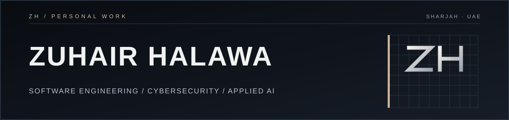

  

  I build software that goes beyond the demo — secure systems, AI tools, and products people can use.
   
  Computer Science · Engineering-minded · Building in the UAE

  <a href="https://www.linkedin.com/in/zuhair-hussein-halawa/">LinkedIn</a>
  &nbsp; / &nbsp;
  <a href="https://nfcer.ae">NFC'er</a>
  &nbsp; / &nbsp;
  <a href="https://github.com/zuhairhalawa?tab=repositories">Public repositories</a>
  &nbsp; / &nbsp;
  <a href="mailto:zuhairhalawa215@gmail.com">Contact</a>

---

### Selected work

**01 &nbsp; [StudyAI](https://github.com/zuhairhalawa/studyai)** · `PUBLIC`  
A local-first study platform for lecture imports, spaced-repetition flashcards, practice exams, and an optional AI tutor grounded in course material.  
React · TypeScript · Cloudflare Workers · Gemini

**02 &nbsp; [NFC'er](https://nfcer.ae)** · `FOUNDER`  
Building an NFC products business and its commerce platform, including smart business cards and digital profiles.  
Laravel · PHP · JavaScript · MySQL · NFC

**03 &nbsp; RELAY** · `PRIVATE / EARLY BETA`  
An experimental end-to-end encrypted messenger. The implementation is private and has not undergone an independent security audit.  
Java · React · TypeScript · Web Crypto

**04 &nbsp; [ZeroTrace Lab / BioHACK3D '26](https://csaw.io/competition/biohack-3d)** · `PRIVATE / RESEARCH`  
Preparing for the BioHACK3D final with computer-vision and adversarial-ML research around physical authentication. Source publication is pending review.  
Python · PyTorch · OpenCV · FastAPI · React

**05 &nbsp; AI-generated code security research** · `GRADUATION PROJECT`  
Exploring automated detection and repair of security and maintainability defects in LLM-generated code.  
Python · Semgrep · Bandit · Ruff · Trivy

**06 &nbsp; Algorithm visualizations** · `PUBLIC`  
Interactive explorations of [Longest Increasing Subsequence](https://github.com/zuhairhalawa/lis-visualizer) and [Longest Path / NP-completeness](https://github.com/zuhairhalawa/longest-path-visualizer).

---

### Credentials

**Cisco** · [Introduction to Modern AI](https://www.credly.com/badges/ffa53aed-add3-48ed-a223-d5235f6ead5f)  
**Cisco** · [Computer Hardware Basics](https://www.credly.com/badges/bb47ec84-7da8-42d1-b45c-7a02bd4f0a8e/linked_in_profile)

Digital credentials open on Credly for verification.

---

### Engineering toolkit

`Python` `TypeScript` `Java` `PHP` `React` `Laravel` `FastAPI` `Docker` `Linux` `GitHub Actions`

Security & quality: Semgrep · Bandit · Trivy · Gitleaks · Ruff · PHPUnit · Playwright

---

<table>
  <tr>
    <td width="70%">
      <strong>Backing good engineering</strong> 
      I welcome project sponsorship, open-source support, and thoughtful collaborations. Reach out if you'd like to help build something useful.
    </td>
    <td align="right">
      
    </td>
  </tr>
</table>

Build carefully. Test what matters. Ship what works.

